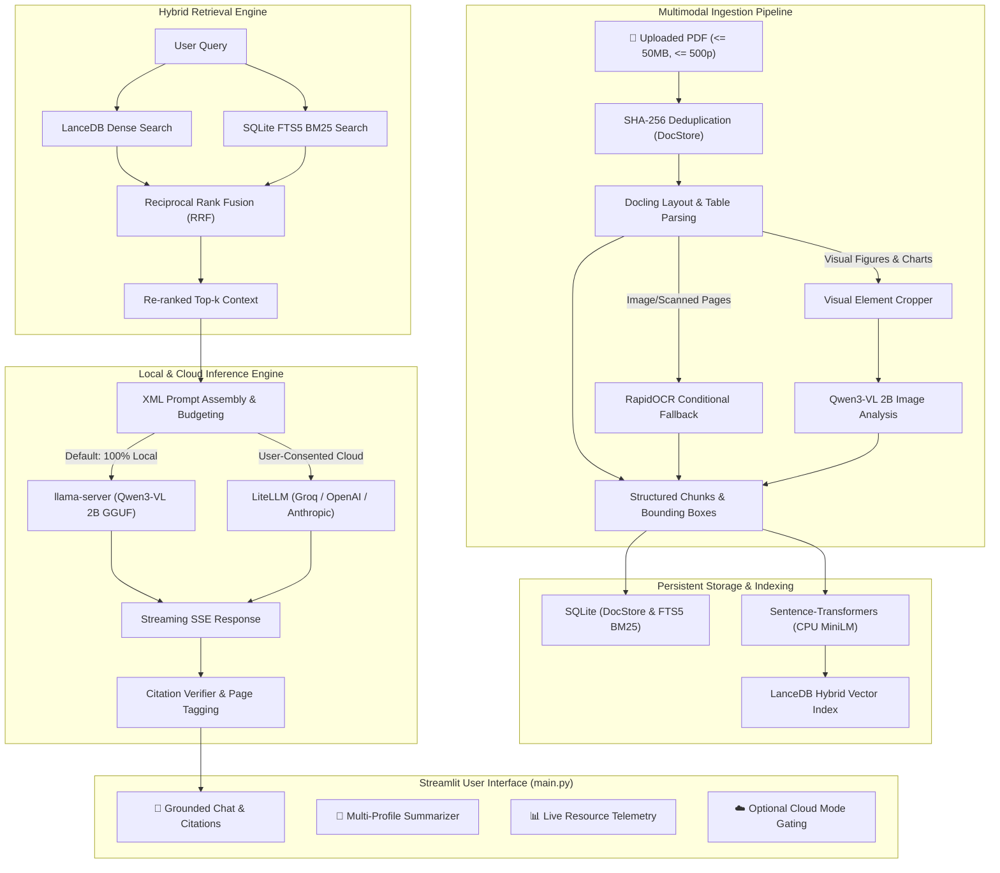

# 📄 Local-First Multimodal PDF Intelligence System

> A production-grade, local-first Retrieval-Augmented Generation (RAG) assistant with visual document intelligence, hybrid dense-lexical search, grounded multi-page citations, and optional privacy-preserving cloud inference.

[](https://www.python.org/)
[](https://streamlit.io/)
[](https://github.com/ggerganov/llama.cpp)
[](https://lancedb.com/)
[](LICENSE)
[](tests/)

---

## 🌟 Highlights & Key Capabilities

- 🔒 **100% Local-First Privacy (Zero Data Egress)**: Runs entirely on your hardware with local models. No document text, embeddings, or queries ever leave your machine by default.
- 👁️ **Multimodal Document Intelligence**: Ingests digital text, parses complex tables, conditionally triggers **RapidOCR** on scanned pages, crops visual figures/charts, and describes them via **Qwen3-VL 2B** Vision-Language Model.
- ⚡ **Tuned for 4 GB VRAM (RTX 3050)**: Optimized memory footprint running quantized `qwen3-vl-2b-instruct-q4_k_m.gguf` with `mmproj-f16` in ~2.4 GB VRAM, safely below the 4 GB ceiling.
- 🔍 **Hybrid Dense + Lexical Retrieval**: Combines semantic embeddings (`all-MiniLM-L6-v2`, 384-dim) with full-text keyword search (BM25 / SQLite FTS5) using **Reciprocal Rank Fusion (RRF)**.
- 🎯 **Verifiable Page Citations**: Anti-hallucination XML prompt framing with automatic citation verification. Interactive citation badges show source snippets and page tags.
- 📑 **Multi-Profile Map-Reduce Summarization**: Five distinct summarization profiles (*Executive*, *Technical*, *Action Items*, *ELI5*, *TL;DR*) with content-hash caching.
- 📊 **Real-Time Resource Telemetry**: Live sidebar monitoring of GPU VRAM, process RAM (RSS/VMS), and stage-by-stage latency with 5.0-second TTL caching.
- ☁️ **Informed Cloud Inference Fallback**: Optional user-consented cloud routing (Groq Llama 3.3 70B, OpenAI GPT-4o mini, Anthropic Claude 3.5 Haiku) with strict consent gating and isolated session keys.

---

## 🏗️ System Architecture



---

## 📁 Repository Structure

```
RAG/
├── start.py                    # One-command application launcher (pre-flight checks + Streamlit)
├── setup.py                    # Standard setuptools package & CLI entry points
├── main.py                     # Streamlit frontend & application lifecycle
├── local_llm.py                # Unified AiModel interface & provider orchestration
├── model_provider.py           # BaseModelProvider interface & data contracts
├── llama_cpp_provider.py       # Local llama-server client with loopback SSRF guards
├── litellm_provider.py         # LiteLLM cloud provider adapter with consent gating
├── groq_provider.py            # Dedicated Groq cloud adapter
├── doc_store.py                # SQLite document metadata & chunk storage
├── docling_reader.py           # Docling structured layout & table extraction
├── visual_analyzer.py          # Visual element detection, cropping, and VLM analysis
├── ocr_fallback.py             # RapidOCR conditional optical character recognition
├── hybrid_retriever.py         # LanceDB + BM25 Reciprocal Rank Fusion (RRF) retrieval engine
├── summarizer.py               # Single-pass and map-reduce multi-profile summarizer
├── citation_validator.py       # Strict citation validation & verification
├── prompt_budget.py            # Context window allocation & XML boundary security
├── resource_telemetry.py       # GPU VRAM, process RAM, and latency profiling
├── local_embedding.py          # Sentence-transformers embedding wrapper with shared RAM cache
├── vector_index.py             # In-memory cosine fallback vector index
├── pdf_reader.py               # Memory-safe PDF reader with pypdf fallback
├── upload_validation.py        # PDF magic-byte, size, and page-count validation
├── scripts/
│   ├── benchmark_multimodal.py # Multimodal evaluation benchmark (tables, diagrams, abstention)
│   ├── benchmark_baseline.py   # Baseline retrieval performance suite
│   └── profile_resources.py    # Live VRAM & RAM hardware profiling script
├── docs/
│   ├── RUNBOOK.md              # Installation, model acquisition, and operation guide
│   └── EVALUATION.md           # Benchmark evaluation, VRAM profile, and test metrics
├── tests/                      # Automated Pytest suite (226 tests, 100% passing)
├── requirements.txt            # Production runtime dependencies
└── requirements-lock.txt       # Deterministic deployment lockfile (universal, Python 3.11)
```

---

## 🚀 Quickstart Guide

### 1. Prerequisites

- **Python**: 3.11 or higher
- **NVIDIA GPU**: GeForce RTX 3050 (4 GB VRAM) or higher recommended (CUDA 12.x / 11.8)
- **RAM**: 16 GB system memory
- **llama.cpp**: Pre-built `llama-server` binary on PATH or in project root

### 2. Environment Setup

```bash
# Clone repository
git clone https://github.com/Vittalgb-05/RAG.git
cd RAG

# Create virtual environment
python -m venv .venv

# Activate virtual environment
# Windows (PowerShell):
.venv\Scripts\Activate.ps1
# Linux / macOS:
source .venv/bin/activate

# Install dependencies from lockfile
pip install -r requirements-lock.txt

# Or install in editable mode:
pip install -e .
```

### 3. Acquire Local Models

Download the GGUF model and multimodal projector into a `models/` directory:

```bash
mkdir models

# Download Qwen3-VL 2B Instruct GGUF (~1.4 GB)
curl -L -o models/qwen3-vl-2b-instruct-q4_k_m.gguf https://huggingface.co/Qwen/Qwen2-VL-2B-Instruct-GGUF/resolve/main/qwen2-vl-2b-instruct-q4_k_m.gguf

# Download Multimodal Projector mmproj-f16 (~600 MB)
curl -L -o models/mmproj-f16.gguf https://huggingface.co/Qwen/Qwen2-VL-2B-Instruct-GGUF/resolve/main/mmproj-qwen2-vl-2b-instruct-f16.gguf
```

### 4. Start Local `llama-server`

Run `llama-server` with parameters tuned for 4 GB VRAM:

```bash
llama-server \
  -m models/qwen3-vl-2b-instruct-q4_k_m.gguf \
  --mmproj models/mmproj-f16.gguf \
  -c 4096 \
  -ngl 28 \
  --host 127.0.0.1 \
  --port 8080
```

### 5. Launch RAG Assistant

**Option A: One-Command Launcher (Recommended)**

Run `start.py`, which performs environment pre-flight checks, verifies directory structures, probes `llama-server` connectivity, and automatically boots the Streamlit application:

```bash
python start.py
```

Options:
- `python start.py --port 8501 --host localhost`
- `python start.py --headless`

**Option B: Direct Streamlit Run**

```bash
streamlit run main.py
```

Open your browser to `http://localhost:8501`.

---

## 🔒 Privacy & Security Model

| Security Dimension | Local Mode (Default) | Cloud Mode (Optional) |
|---|---|---|
| **Document Storage** | 100% on-device (SQLite + LanceDB) | 100% on-device (zero egress) |
| **Embeddings** | 100% on-device (CPU MiniLM) | 100% on-device (CPU MiniLM) |
| **Inference Transport** | Local loopback (`127.0.0.1:8080`) | Encrypted TLS to external API |
| **SSRF Mitigation** | Restricts provider host to loopback | Explicit API base endpoints |
| **User Consent** | Not required (stays local) | Mandatory modal confirmation required |
| **API Key Storage** | N/A | Session memory only; never written to disk |

### 🖥️ Workstation Scoping & Deployment Architecture
- **Single-User Workstation Target**: The application is designed and benchmarked as a local desktop tool where both Streamlit and `llama-server` execute on the user's workstation (`127.0.0.1`).
- **Session-Scoped Routing**: Inference routing preferences, provider choices, and cloud consent flags are scoped strictly to individual Streamlit sessions (`st.session_state.ai_model`). One session enabling Cloud Mode never mutates or affects other concurrent sessions.
- **Remote / Hosted Cloud Caveat**: Hosting Streamlit on external cloud platforms (such as Streamlit Community Cloud) cannot automatically reach a `llama-server` running on a user's laptop loopback. Cloud deployment requires either dedicated remote model endpoints or private network tunneling (e.g., WireGuard/Tailscale).

---

## 🧪 Running Tests & Quality Gates

The test suite executes 100% offline without requiring active GPUs or network connections:

```bash
# Run complete test suite (217 tests)
pytest tests/ -v

# Run linter checks
ruff check .

# Check code formatting
ruff format --check .
```

---

## 📖 Documentation & Runbooks

- **[Operational Runbook (`docs/RUNBOOK.md`)](docs/RUNBOOK.md)**: Detailed step-by-step installation, hardware tuning, startup flags, and troubleshooting procedures.
- **[Evaluation Report (`docs/EVALUATION.md`)](docs/EVALUATION.md)**: Test metrics, VRAM consumption profiling, retrieval latency benchmarks, and citation precision audits.

---

## 📄 License

This project is licensed under the MIT License. See [LICENSE](LICENSE) for details.
