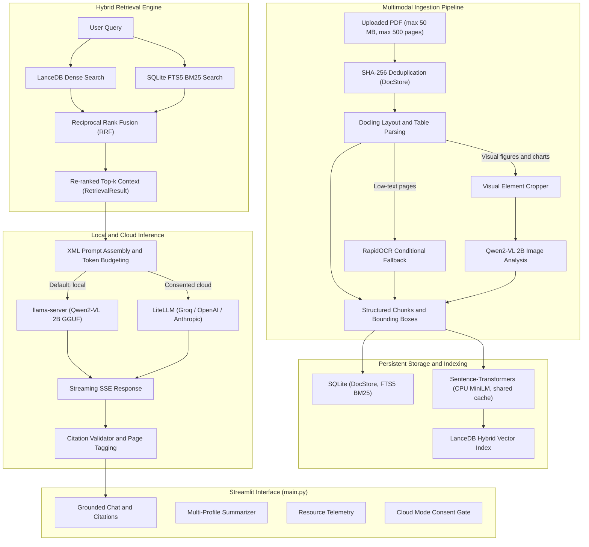

# Local-First Multimodal PDF Intelligence System

> A production-grade, local-first Retrieval-Augmented Generation (RAG) assistant with visual document intelligence, hybrid dense-lexical search, grounded page-level citations, and optional consent-gated cloud inference.

[](https://www.python.org/)
[](https://streamlit.io/)
[](https://github.com/ggerganov/llama.cpp)
[](https://lancedb.com/)
[](LICENSE)
[](tests/)

---

## Highlights

- **Local-first privacy (zero data egress by default).** Ingestion, OCR, embeddings, vector search, and inference all run on your hardware. No document text, embeddings, or queries leave the machine unless you explicitly enable Cloud Mode.
- **Multimodal document intelligence.** Parses digital text and tables with Docling, conditionally invokes RapidOCR on low-text pages, crops visual figures and charts, and describes them with the Qwen2-VL 2B vision-language model.
- **Tuned for 4 GB VRAM (RTX 3050).** Quantized Qwen2-VL 2B weights (kept under the legacy `qwen3-vl-2b-instruct-q4_k_m.gguf` filename) with `mmproj-f16` profile at ~3.45 GB projected peak VRAM with ~646 MB headroom, under the 3.8 GB safety target.
- **Hybrid dense + lexical retrieval.** Semantic embeddings (`all-MiniLM-L6-v2`, 384-dim, CPU-pinned) combined with BM25 keyword search via Reciprocal Rank Fusion (RRF), persisted in LanceDB with SQLite metadata.
- **Verifiable page citations.** XML-framed grounded prompts with an automated citation validator (precision gate) and abstention behavior for unanswerable questions. The UI renders citation badges, source chips, and an evidence drawer.
- **Multi-profile summarization.** Five profiles — Overview, Detailed, Study Notes, Tables & Figures, Findings — generated via single-pass or map-reduce paths with SHA-256 content-hash caching in SQLite.
- **Resource telemetry.** Live sidebar monitoring of GPU VRAM, process RAM, and stage latency with TTL-cached `nvidia-smi` polling that degrades gracefully on CPU-only hosts.
- **Consent-gated cloud fallback.** Optional routing to Groq (Llama 3.3 70B), OpenAI (GPT-4o mini), or Anthropic (Claude 3.5 Haiku) through LiteLLM. Cloud Mode requires explicit dialog consent; keys live in session memory only.

---

## System Architecture



---

## Repository Structure

```
RAG/
├── start.py                    # One-command launcher (pre-flight checks + Streamlit)
├── setup.py                    # Standard setuptools package and CLI entry points
├── main.py                     # Streamlit frontend and application lifecycle
├── local_llm.py                # Unified AiModel interface and provider orchestration
├── model_provider.py           # BaseModelProvider interface and data contracts
├── llama_cpp_provider.py       # Local llama-server client with loopback SSRF guards
├── litellm_provider.py         # LiteLLM cloud adapter with consent gating
├── groq_provider.py            # Dedicated Groq cloud adapter
├── doc_store.py                # SQLite document metadata, chunk, and summary storage
├── docling_reader.py           # Docling structured layout and table extraction
├── visual_analyzer.py          # Visual element detection, cropping, and VLM analysis
├── ocr_fallback.py             # Conditional RapidOCR with per-page fault isolation
├── hybrid_retriever.py         # LanceDB + BM25 Reciprocal Rank Fusion retrieval engine
├── summarizer.py               # Single-pass and map-reduce multi-profile summarizer
├── citation_validator.py       # Citation precision validation and abstention detection
├── prompt_budget.py            # Context window allocation and XML boundary security
├── resource_telemetry.py       # GPU VRAM, process RAM, and latency profiling
├── local_embedding.py          # Sentence-transformers wrapper with shared process cache
├── vector_index.py             # Pure-stdlib in-memory cosine fallback index
├── pdf_reader.py               # Memory-safe pypdf reader with chunking
├── upload_validation.py        # PDF magic-byte, size, and page-count validation
├── models.py                   # Pydantic v2 canonical schemas (Document, Page, Chunk, ...)
├── scripts/
│   ├── benchmark_multimodal.py # Multimodal evaluation (tables, diagrams, abstention)
│   ├── benchmark_baseline.py   # Baseline retrieval performance suite
│   └── profile_resources.py    # VRAM and RAM hardware profiling harness
├── docs/
│   ├── RUNBOOK.md              # Installation, model acquisition, operations guide
│   ├── EVALUATION.md           # Benchmarks, VRAM profile, and test metrics
│   └── LOCAL_INFERENCE.md      # llama-server tuning reference for 4 GB GPUs
├── tests/                      # Automated pytest suite (248 tests, 100% passing)
├── requirements.txt            # Production runtime dependencies
├── requirements-lock.txt       # Deterministic deployment lockfile (Python 3.11)
└── requirements-test.txt       # Test-only dependencies
```

---

## Quickstart

### 1. Prerequisites

- **Python** 3.11 or higher
- **NVIDIA GPU** GeForce RTX 3050 (4 GB VRAM) or higher recommended (CUDA 12.x / 11.8)
- **RAM** 16 GB system memory
- **llama.cpp** pre-built `llama-server` binary on PATH or in the project root

### 2. Environment Setup

```bash
# Clone repository
git clone https://github.com/Vittalgb-05/RAG.git
cd RAG

# Create virtual environment
python -m venv .venv

# Activate virtual environment
# Windows (PowerShell):
.venv\Scripts\Activate.ps1
# Linux / macOS:
source .venv/bin/activate

# Install dependencies from lockfile
pip install -r requirements-lock.txt

# Or install in editable mode:
pip install -e .
```

### 3. Acquire Local Models

Download the GGUF model and multimodal projector into a `models/` directory:

```bash
mkdir models

# Download Qwen2-VL 2B Instruct GGUF (~1.4 GB; saved under the legacy filename
# the app expects)
curl -L -o models/qwen3-vl-2b-instruct-q4_k_m.gguf https://huggingface.co/Qwen/Qwen2-VL-2B-Instruct-GGUF/resolve/main/qwen2-vl-2b-instruct-q4_k_m.gguf

# Download Multimodal Projector mmproj-f16 (~600 MB)
curl -L -o models/mmproj-f16.gguf https://huggingface.co/Qwen/Qwen2-VL-2B-Instruct-GGUF/resolve/main/mmproj-qwen2-vl-2b-instruct-f16.gguf
```

### 4. Start Local `llama-server`

Run `llama-server` with parameters tuned for 4 GB VRAM (batch caps prevent transient spikes during prompt ingestion; see `docs/LOCAL_INFERENCE.md` for 8K-context and Flash Attention options):

```bash
llama-server \
  -m models/qwen3-vl-2b-instruct-q4_k_m.gguf \
  --mmproj models/mmproj-f16.gguf \
  -c 4096 \
  -ngl 28 \
  -b 512 -ub 512 \
  --host 127.0.0.1 \
  --port 8080
```

### 5. Launch RAG Assistant

**Option A: One-command launcher (recommended).**

`start.py` performs environment pre-flight checks, verifies directory structures, probes `llama-server` connectivity, and boots Streamlit:

```bash
python start.py
```

Options:

- `python start.py --port 8501 --host localhost`
- `python start.py --headless`
- `python start.py --llama-host 127.0.0.1 --llama-port 8080`

**Option B: Direct Streamlit run.**

```bash
streamlit run main.py
```

Open `http://localhost:8501` in your browser.

---

## Privacy and Security Model

| Dimension | Local Mode (default) | Cloud Mode (optional) |
|---|---|---|
| **Document storage** | On-device (SQLite + LanceDB) | On-device (zero egress) |
| **Embeddings** | On-device (CPU MiniLM) | On-device (CPU MiniLM) |
| **Inference transport** | Local loopback (`127.0.0.1:8080`) | Encrypted TLS to provider API |
| **SSRF mitigation** | Provider host restricted to loopback | Explicit API base endpoints |
| **User consent** | Not required (stays local) | Mandatory confirmation dialog |
| **API key storage** | N/A | Session memory only, never written to disk |

### Deployment Notes

- **Single-user workstation target.** Streamlit and `llama-server` are designed to run on the same machine (`127.0.0.1`).
- **Session-scoped routing.** Provider choice, Cloud Mode, and consent flags live in per-session Streamlit state. One session enabling Cloud Mode never affects concurrent sessions.
- **Hosted deployment caveat.** A Streamlit instance hosted on an external platform cannot reach a `llama-server` on your laptop's loopback. Remote deployment requires dedicated model endpoints or private-network tunneling (for example, WireGuard or Tailscale).

---

## Running Tests and Quality Gates

The suite runs fully offline with mocked inference, embeddings, and GPU telemetry:

```bash
# Full suite (248 tests)
pytest tests/ -v

# Linter
ruff check .

# Formatting
ruff format --check .
```

CI (`.github/workflows/ci.yml`) installs from the lockfile, regenerates the synthetic PDF corpus, then runs lint, format check, and the full suite on Python 3.11.

---

## Documentation

- [Operational Runbook (`docs/RUNBOOK.md`)](docs/RUNBOOK.md) — installation, hardware tuning, startup flags, troubleshooting.
- [Evaluation Report (`docs/EVALUATION.md`)](docs/EVALUATION.md) — test metrics, VRAM profiling, retrieval latency, citation precision.
- [Local Inference Reference (`docs/LOCAL_INFERENCE.md`)](docs/LOCAL_INFERENCE.md) — `llama-server` flags, context scaling, VRAM budget.

---

## License

This project is licensed under the MIT License. See [LICENSE](LICENSE) for details.
